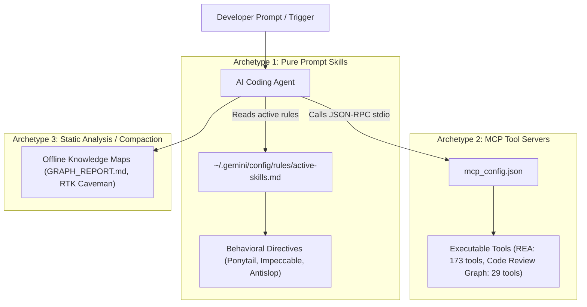
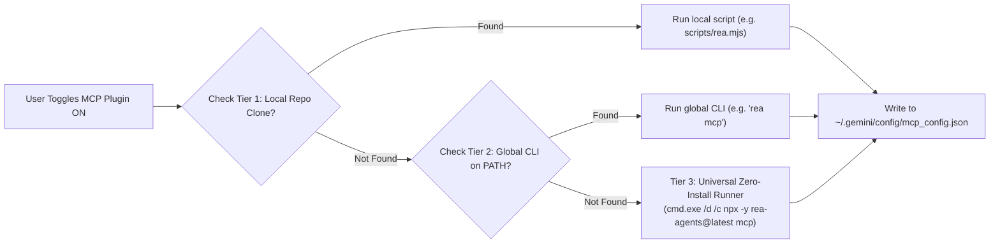

# Skill Switcher — Architecture, MCP Plugins & Dynamic Portability Guide

> **Official Guide**: Explaining how skills, MCP servers, and token-reduction plugins are designed, executed, and made 100% portable across dynamic users and cross-machine environments.

---

## 1. Executive Summary & Core Philosophy

**Skill Switcher** is an offline-first orchestrator built for modern AI coding agents (**Antigravity IDE**, **Claude Code**, **Gemini CLI**, **Cursor**).

Instead of permanently bloating your model's 200k–1M context window with hundreds of conflicting instructions, Skill Switcher lets you:
1. **Hot-swap specialized behavioral skills** directly into `~/.gemini/config/rules/active-skills.md`.
2. **Toggle heavy MCP tool servers** on/off inside `mcp_config.json` without manually editing config files.
3. **Enforce surgical diffs & AST graph queries** that reduce token burn by **50%–85%**.

---

## 2. The 3 Archetypes of Skills & Plugins

Not all skills work the same way. Understanding these three archetypes is critical for integration:



### Archetype 1: Pure-Prompt & Behavioral Skills (Zero-Install)
* **Examples**: `ponytail`, `impeccable`, `antislop`, `gsap-core`, `motion-dev-animations`, `taste-skill`.
* **How They Work**: Pure markdown instructions (`SKILL.md`) injected into the agent's active system prompt.
* **Prerequisites**: **Zero binaries or background processes**. Works instantly on any machine, Linux, macOS, or Windows.
* **Storage Location**: Bundled inside `Skills-Switcher/.agents/skills/<skill-name>/SKILL.md`.

### Archetype 2: MCP Tool Servers (Execution-Backed)
* **Examples**: 
  * **`rea` (Reverse Engineer Anything)**: 173 tools for decompiling native binaries, inspecting .NET CIL assemblies, extracting Electron ASAR packages, and mapping CDP browser targets.
  * **`code-review-graph`**: 29 tools for AST queries, semantic node search, and blast-radius impact analysis.
* **How They Work**: Standalone processes launched by the IDE communicating over JSON-RPC `stdio`.
* **Configuration**: Dynamically registered in `~/.gemini/config/mcp_config.json`.
* **Portability Challenge**: If an MCP server references a hardcoded path (e.g. `C:\Users\1000859\...`), it breaks immediately on any other teammate's computer.

### Archetype 3: Static Analysis & Offline Compaction
* **Examples**: `graphify` (codebase dependency grapher), `zipai-optimizer` (log output truncation), `OmniRoute` (prompt compression).
* **How They Work**: Compiles relationships once into offline Markdown reports (`GRAPH_REPORT.md`) or enforces shell-pipe filters so multi-megabyte terminal dumps never flood the LLM context.

---

## 3. The 3-Tier Dynamic Portability Architecture

To ensure **any teammate, new user, or CI pipeline** can clone `Skills-Switcher` and immediately use tool-backed MCP plugins, Skill Switcher uses a **3-tier resolution ladder**:



### Why Tier 3 (Zero-Install) is a Superpower:
* **No Git Cloning Needed**: A dynamic user does **NOT** need to clone the 3,000-file REA repository or install Python virtual environments.
* **Automatic Cloud Fetch**: `npx -y rea-agents@latest mcp` automatically downloads the latest verified release from npm on demand into a temporary sandbox.
* **Cross-User Independence**: The command does not contain username paths or machine-specific drive letters.

---

## 4. How to Add a New Skill or MCP Plugin to Skills-Switcher

Follow this standard 4-step checklist when adding any new skill or MCP tool:

### Step 1: Place the Skill Bundle in `.agents/skills/`
Create a folder containing `SKILL.md`:
```
Skills-Switcher/.agents/skills/<your-skill-id>/SKILL.md
```
*(If the skill has companion docs, include a `references/` subdirectory).*

### Step 2: Register in `js/data/repos-catalog.js`
Add your repository and subskills to the `REPOS` array:
```javascript
{
  "id": "repo-<name>",
  "name": "org/repo-name",
  "title": "Human Readable Title",
  "repoUrl": "https://github.com/org/repo-name",
  "desc": "Short overview of capability",
  "cat": "mcp", // or 'devtools', 'frontend', 'ai'
  "subcat": "tools",
  "stars": "5.2k",
  "lang": "TypeScript",
  "langColor": "#3178c6",
  "updated": "Today",
  "icon": "mcp",
  "subskills": [
    {
      "id": "your-skill-id",
      "name": "Display Name",
      "cat": "mcp",
      "desc": "What the skill does",
      "purpose": "Why the AI should invoke this skill",
      "trigger": "/your-trigger, keyword1, keyword2",
      "example_prompt": "Run /your-trigger on ./src/index.ts",
      "files": [
        ".agents/skills/your-skill-id/SKILL.md"
      ],
      "act": "DIRECTIVE: When to use this skill over standard tools.",
      "repoName": "org/repo-name",
      "repoUrl": "https://github.com/org/repo-name",
      "requiresApiKey": false
    }
  ]
}
```

### Step 3: Wire Up the Server Toggle in `skill-gui-server.ps1`
1. In `Get-PluginRegistry`: Add discovery logic for the tool schemas in `~/.gemini/antigravity-ide/mcp/<plugin-id>`.
2. In `Set-PluginToggle`: Add the 3-tier resolution fallback:
   ```powershell
   } elseif ($pluginId -eq "my-plugin") {
       $localScript = Join-Path $USER_HOME "path/to/script.js"
       $globalCmd = Get-Command "my-plugin" -ErrorAction SilentlyContinue
       
       if (Test-Path $localScript) {
           $srvObj = [pscustomobject]@{ command = "node"; args = @($localScript, "mcp") }
       } elseif ($globalCmd) {
           $srvObj = [pscustomobject]@{ command = $globalCmd.Source; args = @("mcp") }
       } else {
           # Universal Tier 3 runner
           $srvObj = [pscustomobject]@{ command = "cmd.exe"; args = @("/d", "/c", "npx", "-y", "my-plugin@latest", "mcp") }
       }
       $mcpData.mcpServers | Add-Member -MemberType NoteProperty -Name "my-plugin" -Value $srvObj -Force
   }
   ```

### Step 4: Add Card Icon in `pages/plugins.html`
In `getPluginIcon(id)`, add your case:
```javascript
case 'my-plugin':
  return '⚡';
```

---

## 5. Verification Checklist

To verify your integration before pushing:
1. **Verify Local Detection**:
   Make a request to `GET http://localhost:7891/verify-skills` — your skill should show `"installed": true, "location": "workspace"`.
2. **Verify Plugin Registry**:
   Make a request to `GET http://localhost:7891/plugins` — your plugin should be listed with correct tool counts and active status.
3. **Verify Toggle Idempotency**:
   Click **Toggle** on the Plugins Hub — check that `~/.gemini/config/mcp_config.json` receives the server object without corrupting existing entries.
4. **Trigger Verification in AI**:
   Ask your AI agent:
   > *"Run a test with `/your-trigger` to inspect `./target`."*
   Confirm the agent reads the skill rules and calls the expected MCP tools.
